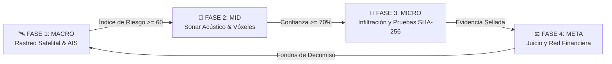

# 🌊 KAIROS: Sombras en Altamar

<p align="center">
  
</p>

<p align="center">
  <b>Aventura de investigación 3D, navegación táctica, inspección logística y sigilo de contrainteligencia.</b><br>
  <i>"En el mar abierto, la ley no llega; la verdad es la única arma."</i>
</p>

<p align="center">
  
  
  
  
  
</p>

---

## 👥 Equipo de Desarrollo y Asignación de Roles (Semanas 10–15)

| Código | Integrante | Cuenta GitHub | Rol Principal | Rama Oficial en GitHub | Etiqueta Trello |
| :---: | :--- | :--- | :--- | :--- | :--- |
| **AB** | **Benites Fierro Alexander Aiken** | [`@Alexander5642`](https://github.com/Alexander5642) | **Dirección de Diseño, UI/UX, Narrativa y Gestión de Escenas** | [`feature/alexander-ui-narrativa`](https://github.com/Efustion23/Kairos_Videojuego/tree/feature/alexander-ui-narrativa) | 🟦 Azul Cian (`Diseño y UI`) |
| **DT** | **Tornero Bermudez Diego Ali Gadiel** | [`@Efustion23`](https://github.com/Efustion23) | **Programación Principal en Unity, Mecánicas, Sonar e IA** | [`feature/diego-gameplay-ia`](https://github.com/Efustion23/Kairos_Videojuego/tree/feature/diego-gameplay-ia) | 🟧 Ámbar/Naranja (`Programación Unity`) |
| **CV** | **Veliz Cochachi Christopher Jesus** | [`@christopher-26`](https://github.com/christopher-26) | **Dirección de Arte 3D, Entorno Marítimo, Iluminación y Audio** | [`feature/christopher-arte-audio`](https://github.com/Efustion23/Kairos_Videojuego/tree/feature/christopher-arte-audio) | 🟩 Verde Esmeralda (`Arte 3D y Audio`) |

👉 **Consulta la guía completa de trabajo y protocolos en:** [`docs/ROLES_Y_GUIA_DE_TRABAJO.md`](docs/ROLES_Y_GUIA_DE_TRABAJO.md)  
👉 **Consulta el desglose de las 18 tarjetas del Tablero de Trello en:** [`docs/PLAN_DE_TAREAS_SPRINTS.md`](docs/PLAN_DE_TAREAS_SPRINTS.md)

---

## 📖 Acerca del Juego

**KAIROS: Sombras en Altamar** es un videojuego de investigación y sigilo no violento inspirado en hechos reales, donde encarnas a un **Inspector Civil de Derechos Humanos y Pesca Marítima**. Tu misión es monitorear los océanos internacionales, detectar buques de flotas oscuras dedicados a la pesca ilegal (INDNR) y la trata laboral, abordar discretamente en medio de tormentas nocturnas, asegurar pruebas con sellado digital criptográfico y llevar a las corporaciones trasnacionales ante los tribunales marítimos.

### 🎯 Los 3 Pilares Fundamentales
1. **La Verdad es el Arma:** No existen armas de fuego ni combate violento. El progreso se logra recopilando evidencias físicas, testimonios de tripulantes y verificando los 11 Indicadores de Trabajo Forzado de la OIT.
2. **Capa sobre Capa:** Cada fase del bucle añade un nuevo sentido instrumental: satélites orbitales, sonar acústico volumétrico, vista térmica, ojos en cubierta y grafos judiciales.
3. **El Océano como Antagonista:** El mar no es un decorado; el estado de la marea (Escala Douglas 0 a 9) determina el cabeceo del buque, las ventanas de abordaje, la visibilidad y el comportamiento de la tripulación.

---

## 🔄 El Bucle de Juego (Las 4 Fases)



1. **Fase 1 — Rastreo Satelital (Macro):** Operación en el globo 3D del Centro de Control. Cruce de datos AIS, radar SAR, luces nocturnas (VIIRS) y cálculo del Índice de Riesgo ($IR$).
2. **Fase 2 — Sonar y Termografía (Mid):** Aproximación táctica en lancha/dron. Pulso acústico sincronizado con el oleaje, reconstrucción volumétrica de vóxeles (0.5 m) del casco y cálculo del Índice de Habitabilidad ($H$).
3. **Fase 3 — Infiltración y Documentación (Micro):** Abordaje nocturno con técnica de *"barco estático, mar en movimiento"*. Sigilo social y ambiental, registro fotográfico en el maletín estanco con hash SHA-256.
4. **Fase 4 — Juicio y Sala de Situación (Meta):** Construcción del grafo de causalidad penal contra empresas fantasma y la cúpula de *Tidewater Holdings*. Sentencias PSMA, Órdenes de Retención (WRO) y retorno presupuestario.

---

## 🌿 Estructura de Ramas en GitHub

* **`main`**: Rama para entregas finales y versiones evaluadas estables.
* **`develop`**: Rama base de integración diaria.
* **Ramas activas de cada integrante:**
  * [`feature/alexander-ui-narrativa`](https://github.com/Efustion23/Kairos_Videojuego/tree/feature/alexander-ui-narrativa): UI/UX, HUDs, Diálogos y Maletín de Pruebas.
  * [`feature/diego-gameplay-ia`](https://github.com/Efustion23/Kairos_Videojuego/tree/feature/diego-gameplay-ia): Movimiento, Físicas, Sonar e Inteligencia Artificial.
  * [`feature/christopher-arte-audio`](https://github.com/Efustion23/Kairos_Videojuego/tree/feature/christopher-arte-audio): Arte 3D Modular, Shaders, Iluminación y Audio.

👉 **Revisa la guía de commits y Pull Requests en:** [`docs/CONVENCION_DE_COMMITS_Y_RAMAS.md`](docs/CONVENCION_DE_COMMITS_Y_RAMAS.md)

---

## 📁 Estructura del Repositorio

```text
Kairos_Videojuego/
├── Assets/
│   ├── Kairos/
│   │   ├── Generated/        # Mallas y assets procedurales
│   │   ├── Models/           # Modelos 3D (Props CC0 Poly Haven, barcos, protagonista)
│   │   ├── Prefabs/          # Prefabs modulares de salas, props y actores
│   │   ├── Resources/        # Audio CC0, datos y fuentes tipográficas
│   │   ├── Scenes/           # Escenas de Unity (Fases y sandboxes individuales)
│   │   ├── Scripts/          # Código fuente en C# dividido por fases
│   │   │   ├── Common/       # Singletons, utilidades e interfaces
│   │   │   ├── Phase1/       # Macro-gameplay y rastreo satelital
│   │   │   ├── Phase2/       # Sonar, vóxeles y termografía
│   │   │   ├── Phase3/       # Infiltración, player agent, IA y maletín
│   │   │   └── Phase4/       # Juicio, grafo financiero y sentencias
│   │   ├── Shaders/          # Shaders de océano, cielo nocturno y efectos térmicos
│   │   └── Tests/            # Pruebas unitarias EditMode y PlayMode
│   └── Settings/             # Configuraciones URP/HDRP y Post-Processing
├── docs/                     # Documentación técnica y diseño
│   ├── images/               # Capturas de pantalla y concept art
│   ├── GDD_RESUMEN_EJECUTIVO.md
│   ├── ROLES_Y_GUIA_DE_TRABAJO.md
│   ├── CONVENCION_DE_COMMITS_Y_RAMAS.md
│   └── PLAN_DE_TAREAS_SPRINTS.md
├── .gitattributes            # Configuración de Git LFS y UnityYamlMerge
├── .gitignore                # Ignorado inteligente de Library, Temp e IDEs
└── README.md
```

---

## 🚀 Guía de Inicio Rápido (Setup para el Equipo)

1. **Clonar con Git LFS:**
   ```bash
   git clone https://github.com/Efustion23/Kairos_Videojuego.git
   cd Kairos_Videojuego
   git lfs install
   git lfs pull
   ```
2. **Cambiar a tu rama de trabajo:**
   * **Alexander:** `git checkout feature/alexander-ui-narrativa`
   * **Diego:** `git checkout feature/diego-gameplay-ia`
   * **Christopher:** `git checkout feature/christopher-arte-audio`
3. **Abrir en Unity Hub:**
   * Seleccionar la versión `Unity 6 LTS (6000.3.x)`.
