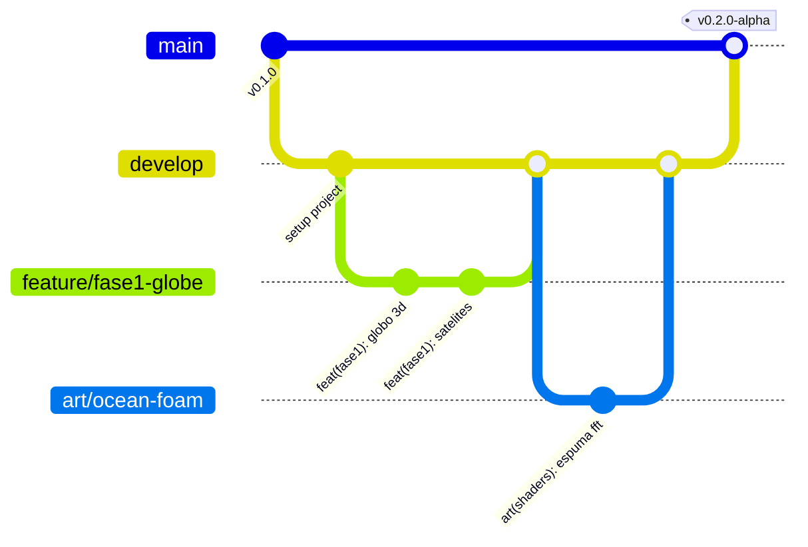

# 🌿 Convención de Commits y Estrategia de Ramas

> **KAIROS: Sombras en Altamar**  
> *Estándar para mantener un repositorio limpio, legible y profesional.*

---

## 1. Estrategia de Ramas (GitFlow Simplificado)

El repositorio utiliza un modelo de dos ramas principales más ramas de trabajo cortas:



### 1.1 Ramas Principales (Permanentes)
* **`main` (Producción / Entregables):**
  * Solo contiene versiones estables y compilables (Milestones, Demos jugables, Vertical Slice).
  * **Nadie hace commits directos a `main`**. Solo se actualiza mediante Pull Request desde `develop`.
* **`develop` (Integración Continua):**
  * Es la rama del día a día donde se juntan los avances de las 3 personas.
  * Todo el equipo parte desde `develop` para crear sus ramas y vuelve a `develop` mediante Pull Request.

### 1.2 Ramas de Trabajo (Temporales)
Cada tarea se desarrolla en una rama propia que se elimina una vez fusionada:

| Prefijo de Rama | Cuándo Usarla | Ejemplo |
| :--- | :--- | :--- |
| `feature/` | Nueva funcionalidad de código o gameplay. | `feature/fase1-globo-3d`, `feature/sha256-maletin` |
| `art/` | Modelos 3D, escenarios, texturas, shaders o iluminación. | `art/buque-potero-modular`, `art/shader-oceano` |
| `ui/` | Menús, HUDs, pantallas y elementos visuales de interfaz. | `ui/hud-sonar`, `ui/pantalla-juicio` |
| `audio/` | Sonido ambiente, FMOD, pistas musicales o efectos. | `audio/tormenta-hidrofono` |
| `fix/` | Corrección de un error o bug encontrado. | `fix/resbalon-cubierta-bug`, `fix/camara-rotacion` |
| `docs/` | Actualizaciones al GDD, README o guías técnicas. | `docs/actualizar-plan-sprint1` |

---

## 2. Convención de Commits (Conventional Commits)

Cada commit debe explicar claramente qué se hizo y a qué módulo pertenece:

### Formato Estándar:
```text
<tipo>(<módulo>): <descripción clara en minúsculas>

[cuerpo opcional con detalles técnicos]
```

### Tipos Permitidos:
* **`feat`**: Nueva mecánica, script o funcionalidad jugable.
  * *Ejemplo:* `feat(fase1): agregar detector de anomalia por apagado de ais`
  * *Ejemplo:* `feat(fase3): implementar linterna e interaccion con puertas`
* **`art`**: Modelos 3D, materiales, shaders, animaciones o diseño de nivel.
  * *Ejemplo:* `art(props): importar cajas y barriles cc0 de poly haven`
  * *Ejemplo:* `art(escenario): ensamblar layout de cubierta superior del hai feng 77`
* **`ui`**: Pantallas de usuario, HUD, Canvas o TextMeshPro.
  * *Ejemplo:* `ui(hud): diseñar barra de deteccion y cono de sospecha`
* **`audio`**: Integración o reemplazo de efectos de sonido y música.
  * *Ejemplo:* `audio(fase2): agregar loop de motor sumergido en hidrofono`
* **`fix`**: Reparación de un bug o comportamiento anómalo.
  * *Ejemplo:* `fix(fase3): corregir cono de vision que atravesaba mamparos`
* **`refactor`**: Reorganización de código sin cambiar su funcionalidad.
  * *Ejemplo:* `refactor(ocean): desacoplar muestreo de altura a interfaz IOceanSampler`
* **`docs`**: Documentación técnica, GDD o guías.
  * *Ejemplo:* `docs(workflow): redactar roles y guia de fusion de unity`
* **`chore`**: Tareas de configuración, Git LFS, paquetes o limpieza.
  * *Ejemplo:* `chore(git): configurar .gitattributes para lfs y unityyamlmerge`

---

## 3. Proceso de Pull Request (PR) y Revisión

1. **Título del PR:** Debe usar el mismo estándar del commit (ej: `feat(fase1): simulador de flotas orbital`).
2. **Descripción:** Explicar brevemente:
   * ¿Qué se hizo?
   * ¿Cómo probarlo en Unity? (Nombre de la escena de prueba o prefab a inspeccionar).
   * Confirmar que compila sin errores en la consola de Unity.
3. **Aprobación:** Al menos **una de las otras dos personas del equipo debe revisar y aprobar el PR** en GitHub antes de hacer *Merge*.
4. **Tipo de Merge:** Usar preferentemente **Squash and Merge** o **Rebase and Merge** para mantener el historial de `develop` limpio y lineal.

