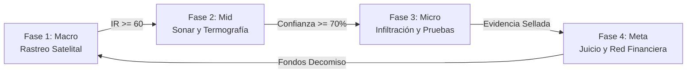

# 🌊 KAIROS: Sombras en Altamar — Resumen Ejecutivo del GDD

> **Documento Oficial de Referencia de Diseño y Arquitectura**  
> *Versión condensada del GDD para consulta rápida del equipo de desarrollo.*

---

## 1. Visión General del Proyecto

* **Título:** *KAIROS: Sombras en Altamar*
* **Género:** Aventura de investigación 3D, navegación táctica, inspección logística y sigilo de contrainteligencia no violento.
* **Motor:** Unity 6 LTS (C#) con High Definition Render Pipeline (HDRP) / Universal Render Pipeline (URP).
* **Plataforma de Lanzamiento 1.0:** PC (Steam / Steam Deck). Puertos posteriores: PS5 y Xbox Series X|S.
* **Tono y Atmósfera:** Realismo documental, suspense marítimo nocturno, denuncia de la pesca INDNR (Ilegal, No Declarada y No Reglamentada) y trata laboral en aguas internacionales.
* **Inspiración Real:** *The Outlaw Ocean Project* (Ian Urbina), informes de *Global Fishing Watch*, *Convenio 188 de la OIT*, *Acuerdo PSMA (FAO)*.

---

## 2. Los 3 Pilares de Diseño

1. **La Verdad es el Arma (Sigilo No Violento):**  
   El jugador es un Inspector Civil de Derechos Humanos y Pesca. No hay armas letales ni barras de vida enemigas. La victoria se obtiene documentando hechos, asegurando la cadena de custodia (SHA-256) y construyendo casos legales irrefutables.
2. **Capa sobre Capa (Revelación Tecnológica):**  
   Cada fase añade un nuevo sentido instrumental:
   * *Fase 1:* Radar orbital, AIS y satélites nocturnos.
   * *Fase 2:* Sonar acústico, escaneo de vóxeles y termografía.
   * *Fase 3:* Visión humana, sigilo ambiental y evidencias físicas.
   * *Fase 4:* Análisis financiero y grafo corporativo.
3. **El Océano como Antagonista Neutral:**  
   La escala Douglas (0 a 9) determina el cabeceo del buque, dificulta el sonar, reduce la visibilidad y abre ventanas críticas de abordaje de pocos segundos.

---

## 3. El Bucle de Juego Principal (Las 4 Fases)

### Fase 1: Macro-gameplay — Rastreo Satelital y Centro de Operaciones
* **Objetivo:** Detectar buques sospechosos en el globo 3D del Centro de Operaciones.
* **Sensores y Capas:**
  * **AIS / VMS:** Transmisión de identidad y posición (detecta apagados intencionales > 12 h).
  * **VIIRS (Luces Nocturnas):** Detección de luces halógenas de poteros calamareros.
  * **SAR (Radar de Apertura Sintética):** Detecta cascos metálicos incluso con AIS apagado.
  * **Óptica Satelital:** Fotografía de alta resolución sujeta a cobertura de nubes.
* **Mecánica Matemática:** Cálculo del **Índice de Riesgo ($IR$)**:
  $$\text{IR} = \min\left(100, \sum (w_i \cdot c_i) \times M_{\text{ruta}}\right)$$
  Donde $w_i$ son ponderaciones de anomalías (apagón, transbordo, merodeo) y $M_{\text{ruta}}$ el multiplicador de zonas de riesgo. Umbral de despliegue: $\text{IR} \ge 60$.

---

### Fase 2: Mid-gameplay — Sonar, Termografía y Reconstrucción Volumétrica
* **Objetivo:** Aproximarse en lancha semirrígida/dron y radiografiar el buque sin ser detectados.
* **Modelo de Vóxeles (0.5 m):** Malla volumétrica en memoria donde cada vóxel almacena densidad ($\rho$), temperatura ($T$) y confianza acumulada.
* **Pulso de Sonar:** Raycasts en ráfaga sincronizados con la cresta de la ola.
* **Cálculo de Calidad de Haz ($Q$):**
  $$Q = \left(1 - \frac{|\theta|}{6^\circ}\right) \cdot (1 - R_{\text{ola}}) \cdot \left(1 - \frac{d - 80}{320}\right)$$
* **Índice de Habitabilidad ($H$):**
  $$H = 0.35 T + 0.25 (1 - \rho) + 0.25 A + 0.15 S$$
  Identifica bodegas frías convertidas en dormitorios clandestinos o falsos mamparos. Al llegar al 70% de confianza, se desbloquea el plano 3D para la infiltración.

---

### Fase 3: Micro-gameplay — Infiltración y Documentación No Violenta
* **Objetivo:** Abordar el pesquero y asegurar pruebas físicas sin ser capturado.
* **Técnica Técnica de Sigilo:** *"Barco estático, mar que se mueve"*. La física del buque y el NavMesh permanecen fijos localmente para garantizar estabilidad de la IA y el control del jugador, mientras el mar y los horizontes se desplazan.
* **Mecánicas:**
  * **Sigilo Social y Ambiental:** Conos de visión dinámicos modificados por clima, lluvia, sombras y postura.
  * **Maletín Estanco (12 ranuras):** Registro fotográfico con sellado digital (SHA-256).
  * **11 Indicadores de la OIT:** Servidumbre por deudas, retención de pasaportes, jornadas de 20 horas, falta de agua potable.
  * **Diálogos con Víctimas:** El Inspector no "salva"; ofrece apoyo y documenta testimonios con consentimiento.

---

### Fase 4: Meta-gameplay — Sala de Situación Judicial y Grafo Financiero
* **Objetivo:** Presentar las evidencias ante el tribunal marítimo y desmantelar el entramado empresarial.
* **Grafo Judicial de Nodos:** Conecta el buque inspeccionado $\rightarrow$ capitán $\rightarrow$ empresa armadora fachada $\rightarrow$ banco / corporación transnacional (*Tidewater Holdings*).
* **Resoluciones y Sentencias:**
  * Emisión de **Orden de Retención (WRO)** ante aduanas.
  * Cierre de puertos según el **Acuerdo PSMA (FAO)**.
  * **Fondo de Decomiso (15% del valor embargado):** Retorna presupuesto para mejorar satélites, lanchas y equipamiento del Centro de Operaciones.

---

## 4. Estructura de Sectores Oceánicos

1. **Sector 1 — Atlántico Sur (Milla 201, Argentina):**
   * *Caso Tutorial:* Potero *Hai Feng 77*.
   * *Enfoque:* Pesca de calamar con focos poteros, incursiones al límite de la ZEE y transbordos opacos.
2. **Sector 2 — Golfo de Guinea (África Occidental):**
   * *Enfoque:* Arrastreros industriales, falsificación de licencias locales y apagones masivos de AIS.
3. **Sector 3 — Océano Índico Occidental:**
   * *Enfoque:* Palangreros de atún de larga distancia, tripulaciones retenidas por más de 2 años sin tocar puerto y desenlace contra *Tidewater Holdings*.

---

## 5. Principios Éticos de Producción

* **Sin Violencia como Espectáculo:** El abuso se comprende mediante huellas contextuales y testimonios, nunca mediante violencia gráfica explícita.
* **Respeto a las Víctimas:** Personajes con trasfondo y nombres reales en sus lenguas nativas (indonesio, tagalo, birmano, ghanés).
* **Precisión Documental:** Ninguna cifra real es inventada; todas corresponden a investigaciones verificadas de la OIT, FAO, AP y GFW.
