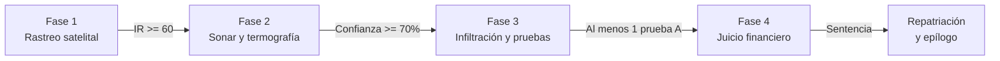

# 🌊 KAIROS: Sombras en Altamar — Resumen Ejecutivo del GDD

> **Resumen para consulta rápida del equipo.**
> *El documento completo es [`KAIROS_GDD_v2.docx`](../KAIROS_GDD_v2.docx). Este resumen describe el juego tal como funciona hoy.*

---

## 1. Visión General del Proyecto

* **Título:** *KAIROS: Sombras en Altamar*
* **Género:** Aventura de investigación 3D, navegación táctica, inspección y sigilo no violento.
* **Motor:** Unity 6 con Universal Render Pipeline (URP).
* **Plataforma:** PC con Windows.
* **Alcance actual:** 1 caso completo, el *Hai Feng 77*, en el Sector 1. Los Sectores 2 y 3 se ven bloqueados en el mapa.
* **Tono:** Investigación tensa pero esperanzadora, sin violencia gráfica.
* **Enfoque de diseño:** Investigar, no castigar. No hay selector de dificultad ni game over a bordo. La tensión está en cuántas personas salen contigo, cuántas pruebas conservas y hasta dónde llega la sentencia.

---

## 2. Los 4 Pilares de Diseño

1. **La verdad es el arma:** No hay combate letal. Se avanza con pruebas válidas, personas rescatadas y sentencias.
2. **Ver lo invisible:** Cada fase añade un sentido: satélite, sonar y termografía, ojo humano y rastro financiero.
3. **El océano es el antagonista neutral:** La escala Douglas (0 a 9) degrada sensores y también ayuda a esconderse.
4. **Dignidad antes que espectáculo:** Las víctimas tienen nombre, voz y decisión propia.

---

## 3. El Bucle de Juego (Las 4 Fases)

### Fase 1: Rastreo satelital
* **Objetivo:** Encontrar al sospechoso entre cinco contactos en un globo 3D.
* **Capas y coste (60 AB al día):** AIS 0, VMS 5, VIIRS 8, SAR 15 y Óptica 25.
* **Índice de Riesgo:** `IR = mín(100, Σ w·c × M_ruta) − 5 × días transcurridos`.
* **Umbral:** IR 60. El *Hai Feng 77* da IR 72 con todas las capas.

### Fase 2: Sonar y termografía
* **Objetivo:** Encontrar el compartimento con personas entre K1 y K5, comparando sus lecturas.
* **Pulso de sonar:** Alcance de 350 m. Rinde al máximo en la cresta de la ola, en una ventana de 1 s.
* **Confianza:** 40 % por marcar bien, 40 % por la lectura de sonar, 10 % por el dron y 10 % por el hidrófono. Hacen falta 70 %.
* **Sospecha:** Llega a 100 si navegas rápido cerca del buque o abusas de los pulsos cercanos. Si te detectan, el buque tira pruebas al mar.

### Fase 3: Infiltración
* **Técnica:** Barco estático; el mar y el cielo se mueven, y la cubierta queda fija para la IA.
* **Sigilo:** Cuatro guardias con rondas, conos de visión y cinco estados. Si te atrapan, vuelves al último punto seguro con tus pruebas.
* **Herramientas:** Cortadora de plasma, bloqueador, aturdidor (1 uso), cámara forense, visor, botiquines y raciones.
* **Maletín:** 13 pruebas selladas con GPS, hora y SHA-256. Caben todas.
* **Personas:** Rodel, Ari, Moussa y Thant deciden si te siguen y si testifican.
* **Salidas:** Patrullera aliada, escolta en sigilo, puente asegurado o retirarte solo.

### Fase 4: Juicio financiero
* **Objetivo:** Conectar las pruebas del buque al beneficiario final en 14 días.
* **Grafo:** Buque → Marea Austral → Cormorán Trade → Tidewater Austral, o Buque → Polar Meridian → Tidewater Austral.
* **Sentencias:** 4 de 11 indicadores de la OIT da Orden de Retención; 7 de 11, Congelación; 11 de 11, Condena.
* **Fondo de Decomiso:** 15 % del embargo y 50.000 ¢ por caso cerrado. Paga mejoras y repatriación.

### Repatriación y epílogo
Cada persona rescatada tiene cinco necesidades. Su epílogo cuenta lo que ocurrió de verdad: su testimonio, lo que se eligió para ella y la sentencia.

---

## 4. Sectores Oceánicos

1. **Sector 1, Atlántico Sur (milla 201, Argentina):** Disponible, con el caso *Hai Feng 77*.
2. **Sector 2, Golfo de Guinea:** Visión futura.
3. **Sector 3, Océano Índico Occidental:** Visión futura, con el desenlace contra *Tidewater Holdings*.

---

### Fase 3: Micro-gameplay — Infiltración y Documentación No Violenta
* **Objetivo:** Abordar el pesquero y asegurar pruebas físicas sin ser capturado.
* **Técnica Técnica de Sigilo:** *"Barco estático, mar que se mueve"*. La física del buque y el NavMesh permanecen fijos localmente para garantizar estabilidad de la IA y el control del jugador, mientras el mar y los horizontes se desplazan.
* **Mecánicas:**
  * **Sigilo Social y Ambiental:** Conos de visión dinámicos modificados por clima, lluvia, sombras y postura; guardias y capitán con modelos humanoid 3D propios, rig Mixamo y linterna halógena de patrulla.
  * **Maletín Estanco (15 ranuras):** Registro fotográfico con sellado digital (SHA-256), incluyendo evidencias documentales, radio VHF satelital y plotter GPS náutico en el puente de mando.
  * **11 Indicadores de la OIT:** Servidumbre por deudas, retención de pasaportes, jornadas de 20 horas, aislamiento, engaño y restricción de movimiento.
  * **Diálogos con Víctimas (4 sobrevivientes con modelos 3D):** Rodel Santos (Filipinas), Ari Wibowo (Indonesia), Moussa Diallo (Senegal) y Thant Zin (Myanmar). El Inspector no "salva"; ofrece apoyo y documenta testimonios con consentimiento.
  * **Sistemas Audiovisuales y Ambientales:** Música adaptativa reactiva a la sospecha, radio táctica VHF/UHF con estática y pitido Roger, audio espacial 3D de pasos metálicos y compresores, partículas de lluvia torrencial y shaders URP de estela de lancha, barrido radial de sonar y resaltado forense.

---

### Fase 4: Meta-gameplay — Sala de Situación Judicial y Grafo Financiero
* **Objetivo:** Presentar las evidencias ante el tribunal marítimo y desmantelar el entramado empresarial.
* **Grafo Judicial de Nodos:** Conecta el buque inspeccionado $\rightarrow$ capitán $\rightarrow$ empresa armadora fachada $\rightarrow$ banco / corporación transnacional (*Tidewater Holdings*).
* **Resoluciones y Sentencias:**
  * Emisión de **Orden de Retención (WRO)** ante aduanas.
  * Cierre de puertos según el **Acuerdo PSMA (FAO)**.
  * **Fondo de Decomiso (15% del valor embargado):** Retorna presupuesto para mejorar satélites, lanchas y equipamiento del Centro de Operaciones.

---

## 4. Estructura de Sectores Oceánicos

1. **Sector 1 — Atlántico Sur (Milla 201, Argentina) [Jugable en v1.0]:**
   * *Caso Principal:* Potero *Hai Feng 77* (con bucle completo de 4 fases, repatriación digna y epílogo personalizado para los 4 pescadores).
   * *Enfoque:* Pesca de calamar con focos poteros, incursiones al límite de la ZEE y transbordos opacos hacia el frigorífico *Polar Meridian*.
2. **Sector 2 — Golfo de Guinea (África Occidental) [Próximamente]:**
   * *Enfoque:* Arrastreros industriales (*Kestrel Explorer*), falsificación de licencias locales y apagones masivos de AIS. Mostrado como *Próximamente* en el mapa orbital v1.0 manteniendo los datos de flota y nodos listos para expansión.
3. **Sector 3 — Océano Índico Occidental [Próximamente]:**
   * *Enfoque:* Palangreros de atún de larga distancia (*Oceanic Crown 9*), tripulaciones retenidas por más de 2 años sin tocar puerto y desenlace contra *Tidewater Holdings*. Mostrado como *Próximamente* en el mapa orbital v1.0.

---

## 5. Principios Éticos de Producción

* **Sin Violencia como Espectáculo:** El abuso se comprende mediante huellas contextuales y testimonios, nunca mediante violencia gráfica explícita.
* **Respeto a las Víctimas:** Personajes con trasfondo y nombres reales en sus lenguas nativas (indonesio, tagalo, birmano, ghanés).
* **Precisión Documental:** Ninguna cifra real es inventada; todas corresponden a investigaciones verificadas de la OIT, FAO, AP y GFW.

* **Sin espectáculo:** El abuso se entiende por huellas y testimonios; nunca se juega ni se muestra en primer plano.
* **Con agencia:** Las víctimas deciden si testifican y si te siguen. Thant decide no testificar, y el juego lo respeta.
* **Con cuidado:** Hay aviso de contenido, opción de omitir descripciones sensibles y enlaces a la OIT y a la OIM.
* **Con ficción:** Todos los buques y empresas son inventados. Cada dato real del Códice lleva su fuente.
