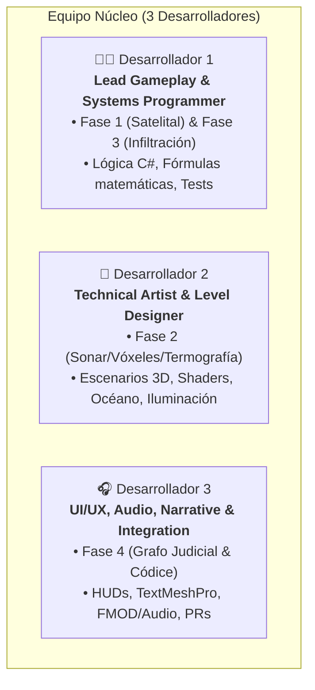

# 👥 Roles y Guía de Trabajo en Equipo (3 Personas)

> **KAIROS: Sombras en Altamar**  
> *Guía operativa para coordinar el desarrollo en Unity sin conflictos de ramas ni colisiones de escenas.*

---

## 1. Asignación de Roles y Responsabilidades

Para maximizar la eficiencia y evitar que dos personas editen los mismos archivos de Unity simultáneamente, el proyecto se divide en 3 áreas bien delimitadas:



### 🧑‍💻 Persona 1: Lead Gameplay & Systems Programmer
* **Enfoque Principal:** Arquitectura de código C#, mecánicas de control del jugador, IA de guardia y simulaciones.
* **Módulos bajo su responsabilidad:**
  * **Fase 1:** Simulador de flotas AIS, reloj de simulación, cálculo del Índice de Riesgo ($IR$).
  * **Fase 3:** `PlayerAgent.cs`, CharacterController, sistema de interacción (`Interactable.cs`), linterna, cámara de registro.
  * **IA de Infiltración:** `SecurityCam.cs`, `VisionFan.cs`, patrullaje de `Walker.cs` / `PersonNpc.cs`, estados de alerta.
  * **Criptografía & Datos:** Sistema de sellado digital SHA-256 para el maletín de pruebas y persistencia.
  * **Pruebas Automatizadas:** Unit tests en `Assets/Kairos/Tests/EditMode`.

### 🎨 Persona 2: Technical Artist & Level Designer
* **Enfoque Principal:** Construcción de escenarios 3D, shaders, atmósfera visual y sistemas volumétricos.
* **Módulos bajo su responsabilidad:**
  * **Escenarios 3D:** Modelado modular con ProBuilder / Blender de los buques (*Hai Feng 77*, arrastreros, reefers), colocación de props de Poly Haven y colisionadores.
  * **Agua y Clima:** Shaders de océano (`Ocean.shader`), oleaje FFT, flotabilidad (Burst) y `NightSky.shader`.
  * **Fase 2:** Sistema de vóxeles (0.5 m) del casco, pulso acústico del sonar y Custom Pass para la vista térmica.
  * **Iluminación & Post-Procesado:** Perfiles URP/HDRP Volume, Ambient Occlusion (SSAO), niebla volumétrica y paleta cromática (azul petróleo, óxido, cobalto).
  * **Optimización Gráfica:** LODs, batching, presupuestos de GPU (máx. 16.6 ms / 60 fps).

### 🎧 Persona 3: UI/UX, Audio, Narrative & Integration (Producer/QA)
* **Enfoque Principal:** Interfaces de usuario, ambientación sonora, narrativa interactiva y control de calidad.
* **Módulos bajo su responsabilidad:**
  * **UI / HUD de las 4 Fases:** Pantalla orbital del satélite, interfaz del sonar, HUD de sigilo (sospecha/visibilidad) y maletín de pruebas.
  * **Fase 4:** `JuicioController.cs`, grafo de evidencias contra *Tidewater Holdings*, pantalla de sentencia y Fondo de Decomiso.
  * **Audio & FMOD:** Diseño sonoro de tormenta, crujido de cuadernas, alarmas, ruidos de maquinaria, hidrófono y pistas musicales CC0.
  * **Narrativa & Códice:** Textos de los 11 Indicadores de la OIT, testimonios de tripulantes y fichas documentales.
  * **Control de Integración:** Revisión de Pull Requests, validación de que el proyecto compile limpio en `develop` y reporte de bugs.

---

## 2. Las 4 Reglas de Oro de Unity en Equipo

> [!CAUTION]
> En Unity, los archivos de escenas (`.unity`) y prefabs (`.prefab`) son archivos serializados en YAML. Si dos personas modifican la misma escena al mismo tiempo, el conflicto de Git es casi imposible de resolver manualmente sin romper la escena.

Sigan estrictamente estas cuatro reglas:

1. **La Regla del Prefab (Nunca trabajen sobre la escena cruda):**  
   * Ningún miembro del equipo debe decorar o programar directamente en la escena principal.  
   * Se crea una escena de trabajo personal (ej. `Sandbox_P1.unity`, `Sandbox_P2_Props.unity`).  
   * Todo objeto, habitación, NPC o módulo de gameplay se construye y guarda como **Prefab** en `Assets/Kairos/Prefabs/`.  
   * En la escena oficial solo se arrastran los Prefabs finales.
2. **Archivos `.meta` Obligatorios:**  
   * Cada vez que agreguen un modelo 3D, script, audio o imagen, Unity genera automáticamente un archivo `.meta`.  
   * **El archivo `.meta` DEBE incluirse en el mismo commit que el archivo de origen.** Si suben un `.cs` o un `.png` sin su `.meta`, a sus compañeros les saldrán referencias rotas ("Missing Script / Missing Material").
3. **Guardar Escena y Proyecto antes de Commitear:**  
   * En Unity: `Ctrl + S` (Save Scene) y luego `File -> Save Project`.  
   * Cierren Unity o deseleccionen la escena antes de hacer git pull/rebase para evitar que Unity sobrescriba cambios en memoria.
4. **Respetar los Límites de Carpeta:**  
   * Programador 1 trabaja principalmente en `Assets/Kairos/Scripts/` y `Tests/`.  
   * Artista 2 trabaja en `Assets/Kairos/Models/`, `Shaders/` y `Generated/`.  
   * UI/Audio 3 trabaja en `Assets/Kairos/Resources/` y `Scripts/UI/`.

---

## 3. Flujo Diario de Trabajo (Paso a Paso)

Antes de empezar a trabajar cada día:

```bash
# 1. Situarse en la rama de integración y actualizar
git checkout develop
git pull origin develop

# 2. Crear una rama de tarea específica (ejemplo Persona 1)
git checkout -b feature/fase1-calculo-riesgo

# 3. Trabajar en Unity, guardar escena y proyecto
# 4. Verificar qué archivos se modificaron
git status

# 5. Agregar archivos (incluyendo siempre los .meta asociados)
git add Assets/Kairos/Scripts/Phase1/RiskCalculator.cs Assets/Kairos/Scripts/Phase1/RiskCalculator.cs.meta

# 6. Hacer commit con la convención estándar
git commit -m "feat(fase1): implementar calculo de indice de riesgo IR con pruebas unitarias"

# 7. Subir la rama a GitHub
git push -u origin feature/fase1-calculo-riesgo

# 8. Abrir un Pull Request en GitHub hacia 'develop' para que el equipo lo revise
```
