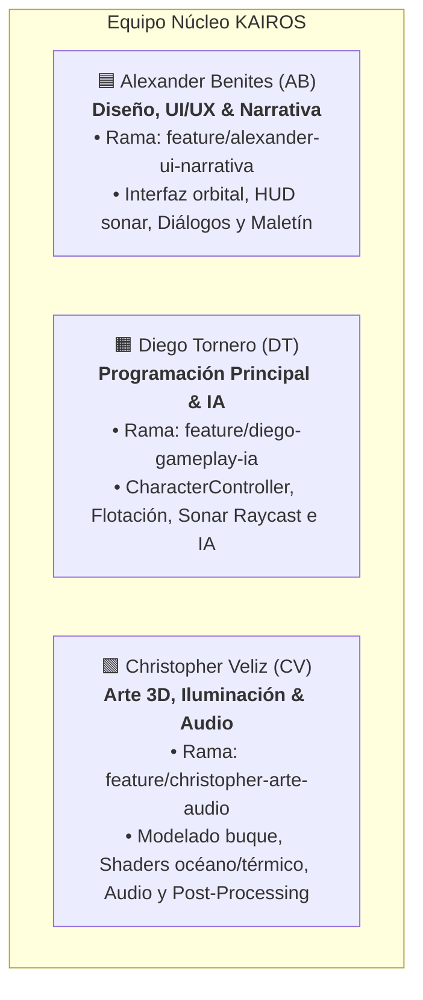
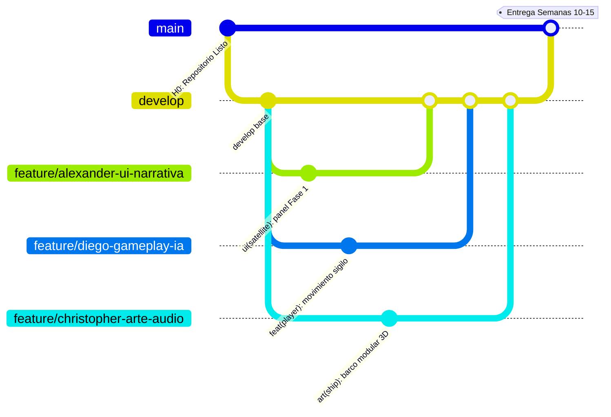

# 👥 Roles y Guía Oficial de Trabajo en Equipo

> **KAIROS: Sombras en Altamar — Desarrollo Unity 6 (Semanas 10–15)**  
> *Asignación oficial de integrantes, roles, ramas en GitHub, etiquetas de Trello y protocolos de trabajo.*

---

## 1. Integrantes del Equipo y Asignación de Roles

| Código | Integrante | Rol Principal | Rama de Trabajo en GitHub | Etiqueta en Trello | Horario de Trabajo |
| :---: | :--- | :--- | :--- | :--- | :--- |
| **AB** | **Benites Fierro Alexander Aiken** | **Dirección de Diseño, UI/UX, Narrativa y Gestión de Escenas** | [`feature/alexander-ui-narrativa`](https://github.com/Efustion23/Kairos_Videojuego/tree/feature/alexander-ui-narrativa) | 🟦 Azul Cian (`Diseño y UI`) | Lun, Mié y Vie / Sáb `18:00 – 21:00` |
| **DT** | **Tornero Bermudez Diego Ali Gadiel** | **Programación Principal en Unity, Mecánicas, Sonar e IA** | [`feature/diego-gameplay-ia`](https://github.com/Efustion23/Kairos_Videojuego/tree/feature/diego-gameplay-ia) | 🟧 Ámbar/Naranja (`Programación Unity`) | Mar, Jue y Vie / Sáb `18:00 – 21:00` |
| **CV** | **Veliz Cochachi Christopher Jesus** | **Dirección de Arte 3D, Entorno Marítimo, Iluminación y Audio** | [`feature/christopher-arte-audio`](https://github.com/Efustion23/Kairos_Videojuego/tree/feature/christopher-arte-audio) | 🟩 Verde Esmeralda (`Arte 3D y Audio`) | Lun, Mié, Jue / Sáb `18:00 – 21:00` |

---

## 2. Detalle de Responsabilidades por Integrante

### 🟦 Alexander Benites (AB) — Dirección de Diseño, UI/UX y Narrativa
* **Rama oficial:** `feature/alexander-ui-narrativa`
* **Etiqueta Trello:** Azul Cian (`Diseño y UI · feature/alexander-ui-narrativa`)
* **Módulos bajo su responsabilidad:**
  * **Sistemas de Interfaz (Canvas & TextMeshPro):**
    * Panel interactivo de rastreo satelital de la Fase 1 (capas AIS, VIIRS y SAR).
    * Retícula cian del visor acústico del sonar y medidor de sospecha (0 a 100).
    * HUD de sigilo, brújula táctica y alertas visuales de proximidad de guardias.
    * Interfaz del maletín de 13 pruebas con sello criptográfico.
    * Menú principal de inicio, créditos y pantalla de sentencia judicial.
  * **Diseño Narrativo & Códice:**
    * Redacción de árboles de diálogo con los pescadores y sobrevivientes.
    * Fichas de los 11 Indicadores de Trabajo Forzado de la OIT.
    * Trazado de mapas 2D de cubiertas y colocación de las pruebas.

### 🟧 Diego Tornero (DT) — Programación Principal en Unity, Mecánicas e IA
* **Rama oficial:** `feature/diego-gameplay-ia`
* **Etiqueta Trello:** Ámbar / Naranja (`Programación Unity · feature/diego-gameplay-ia`)
* **Módulos bajo su responsabilidad:**
  * **Control del Jugador y Físicas:**
    * CharacterController en tercera persona, cámara orbital y movimiento por rampas.
    * Propulsión, giro y flotación de la lancha.
    * Sincronización de la ventana de abordaje con el seno de la ola en popa.
  * **Mecánica del Sonar Acústico (Fase 2):**
    * Pulso de sonar, lecturas por compartimento y detección del casco por capas (`LayerMask`).
    * Marcado del compartimento con personas y cálculo de la Confianza.
  * **Inteligencia Artificial de Vigilancia:**
    * Máquina de estados en NavMesh (`Patrulla`, `Sospecha`, `Alerta`).
    * Conos de visión dinámicos afectados por la noche, la lluvia y la luz.
    * Reacción de guardias ante escora del buque (>15°) y ruidos de pasos.
  * **Cámara de Pruebas y Cierre de Bucle:**
    * Validación de encuadre y enfoque fotográfico para la recolección de pistas.
    * Conexión fluida del bucle completo de las 4 fases.
    * Perfilado de rendimiento a 60 FPS estables y empaquetado de la build final (.exe).

### 🟩 Christopher Veliz (CV) — Dirección de Arte 3D, Entorno Marítimo, Iluminación y Audio
* **Rama oficial:** `feature/christopher-arte-audio`
* **Etiqueta Trello:** Verde Esmeralda (`Arte 3D y Audio · feature/christopher-arte-audio`)
* **Módulos bajo su responsabilidad:**
  * **Escenarios 3D y Modelado Modular:**
    * Greybox modular del casco, puente de mando, bodegas y cubiertas del pesquero *Hai Feng 77*.
    * Texturizado PBR con materiales de acero corroído, óxido ferroso y salitre.
    * Aspecto de las pruebas y de los objetos del buque.
  * **Shaders, Iluminación y Post-Processing:**
    * Shader de oleaje oceánico nocturno y superficie marina.
    * Pulso cian de sonar (`#3FE0D0`) y vista térmica fría/caliente.
    * Posicionamiento de reflectores halógenos amarillos en cubierta, niebla volumétrica y lluvia.
    * Calibración de color grading y bloom en perfiles de Post-Processing.
  * **Diseño y Mezcla de Audio:**
    * Pings acústicos y eco metálico subacuático para el sonar.
    * Audio espacial 3D de pasos sobre chapa metálica, crujidos de casco y maquinaria.
    * Música adaptativa de tensión e infiltración nocturna.

---

## 3. Protocolo de Ramas en Git

1. **`main`**: Rama para versiones evaluadas y entregas finales. Nadie comitea directo a `main`.
2. **`develop`**: Rama común de integración.
3. **Ramas personales activas en GitHub:**
   * `git checkout feature/alexander-ui-narrativa`
   * `git checkout feature/diego-gameplay-ia`
   * `git checkout feature/christopher-arte-audio`

---

## 4. Las 5 Reglas de Oro de Unity en Equipo

1. **No editar a mano lo que crea el generador:**  
   `Kairos > Generar juego` rehace las 5 escenas, `HaiFeng77.prefab`, `Lancha.prefab` y `Assets/Kairos/Generated/`. Todo lo editado a mano en esos archivos se pierde. Para cambiarlos, edita `Assets/Kairos/Scripts/Editor/` y vuelve a generar. Para probar algo aparte, usa una escena propia sin subirla (`Sandbox_Alexander.unity`, `Sandbox_Diego.unity`, `Sandbox_Christopher.unity`).
2. **Archivos `.meta` Obligatorios:**  
   Todo archivo nuevo añadido a Unity (`.cs`, `.png`, `.fbx`, `.prefab`, `.asset`) **debe comitearse junto con su correspondiente archivo `.meta`**.
3. **Guardado Antes de Commitear:**  
   En Unity: presionar `Ctrl + S` y luego `File -> Save Project` antes de hacer `git add`.
4. **Git LFS:**  
   Los modelos 3D, las texturas y los audios se guardan con Git LFS según [`.gitattributes`](../.gitattributes). Ejecuta `git lfs install` una vez y `git lfs pull` después de clonar.
5. **Generar sin pisarse:**  
   Genera siempre fuera de Play Mode y pasa los tests de `Assets/Kairos/Tests` antes del Pull Request. Las escenas generadas no se fusionan a mano: si chocan, fusiona el código del generador y vuelve a generar.
